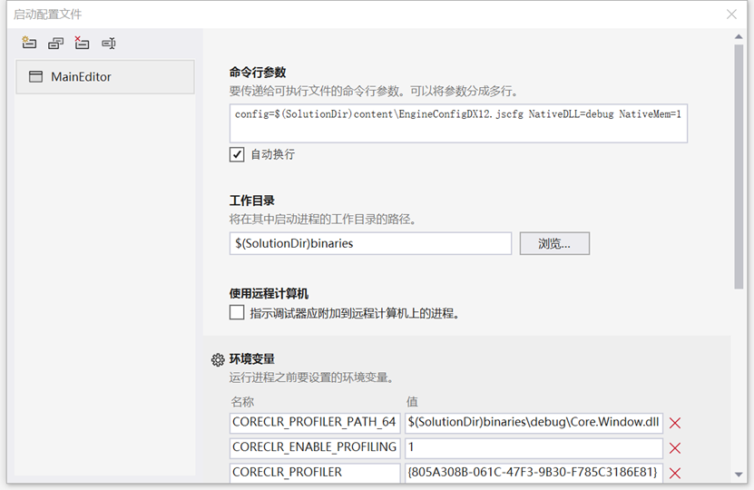
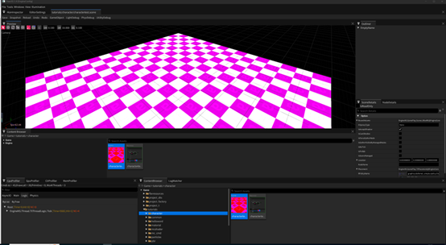
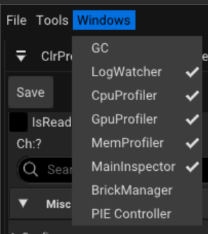
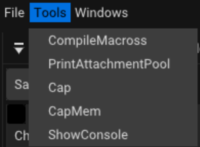
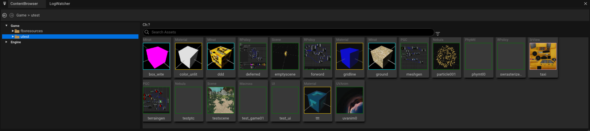
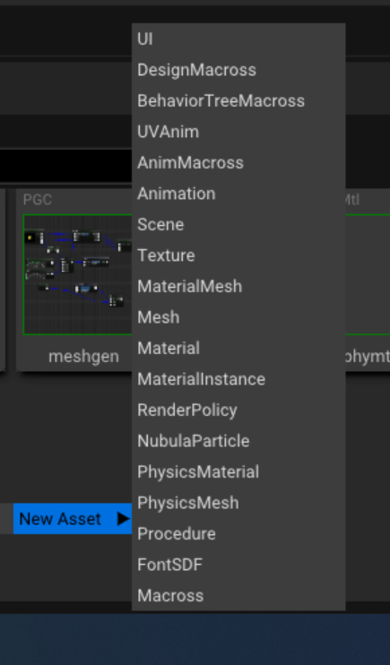

- 环境准备与编译构建
- - 依赖：Visual Studio 2026（MSBuild 18.x、MSVC v145 工具集）、.NET SDK 10.0.4xx、Windows SDK ≥ 10.0.19041、CMake；完整清单与校验规则见 [dependencies.json](../BuildScript/common/dependencies.json) 与 [deps.ps1](../BuildScript/check/deps.ps1)
- - 首次准备运行 Setup.bat：依赖校验 → NuGet restore → 构建代码生成工具 → 生成胶水代码，跑完即可直接在 Visual Studio 里构建
- - 命令行完整构建运行 BuildEngine.bat，参数原样转发给 [build.ps1](../BuildScript/build.ps1)
- - - Configuration：Debug|Release|All（默认 All），只作用于托管工程
- - - NativeDll：debug|release 覆盖 native 编译配置
- - - 其余开关：-SkipRestore -SkipCodeGen -SkipNative -SkipManaged -SkipPlugins -SkipTools -SkipDependencyCheck -CodeGenOnly
- - native 编译配置与代码生成配置同源：都取 content/config/engineconfig_windows_dx12.jscfg 的 NativeDll（cache/config/engine.jscfg 覆盖优先，命令行 -NativeDll 与 /p:TitanNativeDll 最高，缺省 release），不跟随 -Configuration
- - 构建顺序：依赖检查 → NuGet restore → CppWeavingTools/CSharpCodeTools（部署到 binaries/Tools/net10.0）→ 胶水代码（codegen/Windows/NativeBinder）→ LeanCLR（CMake）→ Core.Window（x64）→ 拷贝原生运行时依赖（PhysX/GMP/VC OpenMP）→ 分析器 → Engine.Window 与 MainEditor → 工具 → 插件（Plugins 下 *.plugin 自动发现）→ DataCopyer 反射阶段
- - Visual Studio 里不需要先手工跑 CppWeavingTools / CSharpCodeTools：构建 Core.Window 或 Engine.Window 前 TitanCodeGen.targets 会自动构建工具并生成代码（.codegen.stamp 做增量，/p:SkipTitanCodeGen=true 可跳过）
- - 产物位置：MainEditor/TitanCMD/GameBuilder/TitanProjectEval 与托管引擎 → binaries/net10.0；Core.Window 与原生依赖 → binaries/debug|release；插件 → binaries/Plugins；工具 → binaries/Tools/net10.0；C# 的 obj/bin → intermediate/csharp/<工程相对路径>/
- - 清理重建：删 intermediate 与 cache 目录即可；libclang 由 NuGet 包 libclang.runtime.win-x64 提供，不再需要手工解压压缩包
- - Android APK（Windows 主机）：完整流程、面板逐项说明与排障见 **[Android 构建与 APK 打包](editor/AndroidBuild.md)**
- - - 入口：BuildScript/android/build-android.ps1 -Configuration Debug|Release -Stage All|Native|Managed|Apk（默认 Debug + All），分阶段跑不能跳前置
- - - 工具链位置写在 cache/config/android-toolchain.json（从 BuildScript/android/AndroidToolchain.example.json 复制填绝对路径），预检用 BuildScript/check/check-android-toolchain.ps1 -Stage Native|Managed|Device（exit 0 就绪 / 2 缺工具）
- - - 版本只给下限，取本机满足要求的最新：NDK r27.x 任取最高、CMake ≥3.24、.NET SDK 10（global.json 版本带内取本机最高）、JDK 17+（面板优先 21）；固定 abi=arm64-v8a、stl=c++_static、apiLevel ≥28
- - - 产物：binaries/android/<配置>/libCore.Android.so、binaries/android/net10.0/Engine.Android.dll、Module/AloneGame.Maui/bin/<配置>/net10.0-android/*-Signed.apk（路径另写 cache/android_build/<小写配置>.apk-path.txt）
- - - 编辑器菜单 窗口 → Android Build：只跑「工具链校验（Managed 档）→ 可选 cook → -Stage Apk」，Native/Managed 必须先跑脚本；不要用 Visual Studio 直接构建 AloneGame.Maui
- - macOS（Apple Silicon）：./setup.sh（Core.Mac/setup.sh）＝依赖校验 → 胶水生成（cmake -P Core.Mac/GenerateCodegen.cmake，输出 codegen/Mac）→ configure → build，开关 --config Debug|Release / --skip-codegen / --check-only / --skip-build
- - - 依赖：Xcode CLT、arm64 终端、cmake ≥3.24、ninja、.NET SDK（缺失时自动装到 3rd/tools/dotnet-sdk）、静态 libc++（缺失时自动克隆并构建 llvmorg-22.1.8，需 python3）；按 generated/TitanSources.cmake 校验 PhysX5 / MoltenVK
- - - 产物：binaries/<debug|release>/Core.Mac.dylib；托管用 Core.Mac/dotnet.sh 代替 dotnet：Engine.Mac 传 -p:TitanPlatform=Mac，MainEditor/TitanCMD 按宿主自动选 Mac，都要 -p:SkipTitanCodeGen=true，产物落 binaries/net10.0
- - - SkipTitanCodeGen 会关掉自动反射阶段，必须显式跑 TitanRunDataCopyerStage，否则运行时 PreInitEngine 找不到 DataCopyer
- - - 现状：原生 + Engine.Mac + TitanCMD + DataCopyer 已在真机验证（冒烟 Core.Mac/smoke_titancmd.sh），MainEditor 窗口/GPU 与 Release 尚未验证，详见 Core.Mac/VALIDATION.md
-  启动编辑器
- - 调试运行MainEditor工程
- - VS调试配置：工作目录 $(SolutionDir)binaries，命令行 config=$(SolutionDir)content\config\engineconfig_windows_dx12.jscfg NativeDLL=debug（见 Module/MainEditor/Properties/launchSettings.json）

- - 修改启动配置，其中jscfg文件可以修改引擎的各种启动参数
- - - NativeDll=auto 时命令行的 NativeDLL 才生效，否则以 cache/config/engine.jscfg 的 NativeDll 为准（与编译期 native 配置同源）
- - - 是否开启C++内存分析:NativeMem=1（默认开启，0 关闭）
- - - [引擎配置文件](engine/EngineConfig.md)
- - Cache/DynConfigData.dcd文件是一些当前引擎编辑器配置保存文件
- - - 程序设置配置示例：TtEngine.Instance.DynConfigData.SetConfig("LastPIEName", mCurrentName)
- - - 程序读取配置示例：var cfgName = TtEngine.Instance.DynConfigData.GetConfig("LastPIEName") as RName;
- - - 配置格式：\{key\}:\{TypeString\}=\{Value\}
- - - 希望注释一行，就在行开始用##标志
- - - [支持的配置](editor/DynConfig.md)
-  编辑器总览

- - **[ContentBrowser](editor/ContentBrowser.md)**
- - **[LogWatcher&Command](editor/LogWatcher.md)**
- - **[CpuProfiler](editor/CpuProfiler.md)**
- - **[GpuProfiler](editor/GpuProfiler.md)**
- - **[RenderDoc MCP 环境与项目配置](editor/RenderDocMCP.md)**
- - **[MemProfiler](editor/MemProfiler.md)**
- - **[ClrProfiler](editor/ClrProfiler.md)**
- - **[PIEController](editor/PIEController.md)**
- - **[TitanCMD 命令行工具](editor/TitanCMD.md)**
- - **[CookManager 批次化异步 cook](editor/CookManager.md)**
- - **[Android 构建与 APK 打包](editor/AndroidBuild.md)**
- MainMenu
这里可以打开和关闭一些编辑器的窗口

这里是一些运行时的工具或者功能

- ContentBrowser
双击资产图标可以启动对应资产编辑器

右键空白处可以新建资产

- 带3D预览的编辑器操作
- - **移动**:ASWD或者按住鼠标中键盘移动
- - **绕观察点旋转**:按住Alt键和鼠标左键拖动
- - **摄像机自身旋转**:鼠标右键拖动
- 内置编辑器
- - **[TextureEditor](editor/TextureEditor.md)**
- - **[MeshPrimitiveEditor](editor/MeshPrimitiveEditor.md)**
- - **[MaterialEditor](editor/MaterialEditor.md)**
- - **[MaterialFunctionEditor](editor/MaterialFunctionEditor.md)**
- - **[MaterialInstanceEditor](editor/MaterialInstanceEditor.md)**
- - **[MaterialedMeshEditor](editor.MaterialedMeshEditor.md)**
- - **[NebulaParticleEditor](editor/NebulaParticleEditor.md)**
- - **[RendPolicyEditor](editor/RendPolicyEditor.md)**
- - **[SceneEditor](editor/SceneEditor.md)**
- - **[MacrossEditor](editor/MacrossEditor.md)**
- - **[GameProject Macross HotPatch](editor/GameProjectHotPatch.md)**
- - **[PGCEditor](editor/PGCEditor.md)**
- - **[UIEditor](editor/UIEditor.md)**

- **架构与行业对比**
- - **[Render Graph 与业界主流引擎横向对比](engine/RenderGraph.Industry.Compare.md)**
    - TitanEngine 自研 RDG (`TtRenderGraph` / `TtAttachmentCache`) 与
      UE5 RDG / Unity URP-HDRP RG / Frostbite FrameGraph / Granite / O3DE Atom /
      Stride GraphicsCompositor / Falcor / Bevy bevy_render 的全维度横向对比。
    - 一句话定位: **业界第一档 RDG 能力 + 业界少见的"主渲染管线可视化编辑器"
      + Permutation / RenderPolicy 资产化, 三者同时具备的引擎全球不超过 5 个**。
    - 含演进路线图 (memory aliasing / pass merging / async compute 自动调度等)。
    - 对外宣讲 / 行业汇报 / 招聘材料的"硬数据"统一来源, 持续更新。

- 基础教程
- 在ContentBrowser的tutorials下面有对应的子目录
- - [helloworld](tutorials/helloworld.md)
- - [material](tutorials/material.md)
- - [mcshader](tutorials/mcshader.md)
- - [particles](tutorials/particles.md)
- - [pbr](tutorials/pbr.md)
- - [prefab](tutorials/prefab.md)
- - [renderpolicy](tutorials/renderpolicy.md)
- - [terrain](tutorials/terrain.md)
- - [viewinstance](tutorials/viewinstance.md)
- - [mc_cmd](tutorials/mc_cmd.md)
- - [pivotpainter](tutorials/pivotpainter.md)
- - [character](tutorials/character.md)