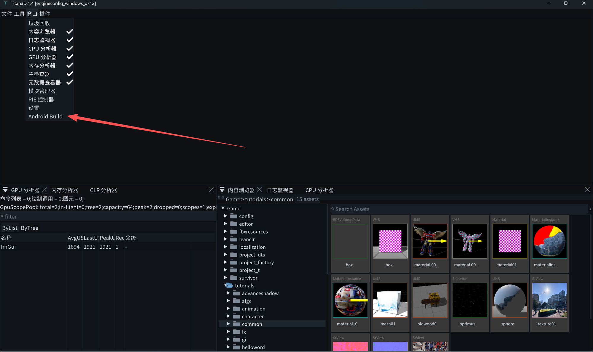
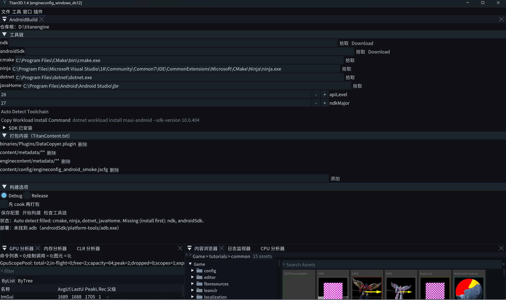

# Android APK 打包（Windows 主机）

TitanEngine 的 Android 交付物是一个 arm64-v8a 的 APK，打包链路只在 Windows 主机上跑，分三步：**原生库（libCore.Android.so）→ 托管层（Engine.Android + DataCopyer）→ 内容暂存 + MAUI 打包**。本文把"装什么版本、怎么配、面板每个开关做什么、失败怎么查"讲清楚；命令与门禁的最终事实源是 `BuildScript/android/build-android.ps1` 与 `BuildScript/check/check-android-toolchain.ps1`，本文与之不一致时以脚本为准。

两条入口，底层是同一条脚本链路：

| 入口 | 能做什么 | 不能做什么 |
| --- | --- | --- |
| `BuildScript\android\build-android.ps1 -Stage All\|Native\|Managed\|Apk` | 全部三阶段 | 需要自己填工具链配置 |
| 编辑器菜单 **窗口 → Android Build** | 工具链校验（Managed 档）、可选 cook、`-Stage Apk`、adb 部署 | 不跑 Native / Managed，不改签名 |

---

## 1. 版本策略：只约束下限，取本机满足要求的最新

"SDK 要哪个版本"这类问题在本仓库里统一按同一条规则处理：**仓库只声明下限或主版本，具体用哪一份由本机已装内容里"满足约束的最新者"决定**，代码和脚本里不出现 `10.0.404`、`27.2.12479018` 这种精确补丁号。

| 组件 | 仓库声明的位置（唯一事实源） | 本机如何挑 | 说明 |
| --- | --- | --- | --- |
| .NET SDK | `global.json` → `sdk.version = 10.0.100`、`rollForward = latestFeature` | 10.0.x 版本带里最高的已装版本（本机现为 10.0.404） | 不能降到 10.0.1xx：该带自带 Roslyn 5.0.0，低于仓库钉的 `Microsoft.CodeAnalysis.CSharp` 5.9.0，编译会静默不出 bind 代码 |
| 托管 TFM（产物目录） | `BuildScript/common/dependencies.json` → `dotnetSdk.targetFramework = net10.0` | 直接读清单 | 全库唯一来源：`binaries/<TFM>/TitanCMD.exe` 等路径由此推出，编辑器代码里不再写死 `net8.0` / `net10.0` |
| NDK | `android-toolchain.json` → `requirements.ndkMajor = 27` | `<androidSdk>\ndk\` 下按 `source.properties` 的 `Pkg.Revision` 取 **r27.x 里最高** | 不钉 `27.2.12479018`；r21 之类的旧主版本会被脚本明确拒绝并给出安装命令 |
| CMake | `requirements.minimumCMakeVersion = 3.24` | 先 `<androidSdk>\cmake\<版本>` 取最高，再 `Program Files\CMake`，再 VS 捆绑 | 只要 ≥ 3.24，具体 3.22/4.x 由本机决定 |
| Ninja | 无版本下限 | 同上顺序（SDK cmake 目录 → VS 捆绑 → `Program Files\CMake`） | |
| JDK | `requirements` 不钉，脚本要求 JDK **17+** | 面板自动探测：21 优先、17 次之 | .NET Android（XA0030）拒绝 JDK 25；新版 Android Studio 自带的 JBR 25 只有在没有 21/17 时才会被选中 |
| Android SDK（platforms / build-tools / adb） | 不钉 | 面板只展示已装清单；打包时由 .NET Android 按 TFM 自己选 | 只需要 `platforms/`、`build-tools/`、`platform-tools/` 里至少一项存在即可被认作合法 SDK 根 |
| apiLevel | `android-toolchain.json` → `apiLevel = 28` | 可调高，**不能低于 28**（引擎运行时下限，与 `Core.Android/CMakeLists.txt` 的 `TITAN_ANDROID_MIN_API_LEVEL` 同一契约） | 面板上 `apiLevel` 输入框直接改这个字段 |
| abi / stl / generator | `arm64-v8a` / `c++_static` / `Ninja` | **固定，不做"取最新"** | 这三项是编译契约（静态 STL、16KB 页对齐、单 ABI），换掉就不是受支持的产物了 |

一句话：**装哪个版本 → 本机发现 + 满足下限取最新；写死的只有编译契约和 apiLevel 28 这个下限。**

另外，面板和 `android-toolchain.json` 落盘时的**缺省值也不在代码里写死**：`abi` / `generator` / `stl` / `requirements.ndkMajor` / `requirements.minimumCMakeVersion` / `requirements.dotnetSdkMajor` 都从同一份 `dependencies.json` 的 `androidToolchain` 读（读不到才用内置兜底）。升 NDK、抬 apiLevel、换 CMake 下限都只改清单。

那 "满足要求的最新" 具体是怎么找的？见第 3 节的面板自动探测。

---

## 2. 一次性准备

### 2.1 工具链配置

```powershell
# 仓库根目录
Copy-Item BuildScript\android\AndroidToolchain.example.json cache\config\android-toolchain.json
```

然后填 `ndk`、`androidSdk`、`cmake`、`ninja`、`dotnet`、`javaHome`（可选 `adb`）六个绝对路径。规则：

- **只写绝对路径**，不展开 `%LOCALAPPDATA%` 这类环境变量，不做猜测；写错就原样报错，不会静默回退到别的 SDK 目录。
- 相对路径按**仓库根**解析，不按调用者的当前目录。
- 位置可用 `-ToolchainConfig <路径>` 或环境变量 `TITAN_ANDROID_TOOLCHAIN_CONFIG` 覆盖。
- `abi` / `generator` / `stl` / `schemaVersion` 由编辑器保存时自动补齐（只补缺，不覆盖已填值）；`requirements` 里的三项就是第 1 节的下限声明。

不想手填就先开面板，点 **Auto Detect Toolchain**，再把结果 **保存配置**。

### 2.2 预检（不编译，只查工具）

```powershell
powershell -NoProfile -ExecutionPolicy Bypass -File BuildScript\check\check-android-toolchain.ps1 -Stage Native    # ndk + cmake + ninja
powershell -NoProfile -ExecutionPolicy Bypass -File BuildScript\check\check-android-toolchain.ps1 -Stage Managed   # 再加 dotnet + androidSdk + javaHome
powershell -NoProfile -ExecutionPolicy Bypass -File BuildScript\check\check-android-toolchain.ps1 -Stage Device    # 再加 adb
```

- 退出码 `0` = 该阶段就绪，`2` = 缺东西（错误文案里会带配置路径和安装提示）。
- 阶段是叠加的：`Native` 只查 NDK/CMake/Ninja（编译 `.so` 不需要 dotnet）；`Managed` 才需要 SDK/JDK；`Device` 才需要 adb。

### 2.3 MAUI 工作负载

只装一次，必须装到 **`global.json` 锁定的版本带**上，否则构建时报 `NETSDK1147`：

```powershell
dotnet workload install maui-android --sdk-version <10.0.x 版本带里最高的已装版本>
```

`--sdk-version` 不能省：本机若同时有 rc 预览版，不带参数会装到"最新的那个 SDK"名下，项目用的却是 `global.json` 解析出来的那个。面板上的 **Copy Workload Install Command** 就是按本机情况生成好的完整命令（版本号是算出来的，不是写死的），复制到 PowerShell 直接跑即可。

---

## 3. 编辑器面板逐项说明

打开方式：菜单 **窗口 → Android Build**（面板标题 `Android Build`）。



面板是一个可停靠窗口，下图是工具链未填全时的状态（状态行会列出探测到什么、还缺什么）：



面板只做"读写配置 + 拼命令行 + 驱动外部进程"，所有门禁都在 `BuildScript` 里。

### 3.1 仓库根

面板启动时从 `AppContext.BaseDirectory` 和当前目录分别向上找 `BuildScript\android\build-android.ps1`，找到的目录即仓库根，显示在顶部 `Repository root:`。找不到会提示"确认编辑器跑在 titanengine 目录树内"。

### 3.2 工具链（Toolchain）

| 控件 | 作用 |
| --- | --- |
| `ndk` `androidSdk` `cmake` `ninja` `dotnet` `javaHome` | 六个绝对路径，对应 `cache\config\android-toolchain.json` 同名字段 |
| **拾取**（Pick） | 目录选择框，回填到对应字段 |
| **Download** | 字段为空时出现在 `androidSdk` / `ndk` / `javaHome` 后面，打开官方下载页（JDK 指向 Temurin 21） |
| `apiLevel` | 写入 `apiLevel`，允许调高，低于 28 会被脚本拒绝 |
| `ndkMajor` | 写入 `requirements.ndkMajor`，升级 NDK 时只改这里，不用改代码 |
| **Auto Detect Toolchain** | 按下面的规则扫本机，把**六个路径字段整体覆盖**为探测结果（`apiLevel` 只在 ≤0 时回填为 `dependencies.json` 的 `androidToolchain.apiLevel`，不覆盖你的选择）；缺的组件在状态行列出 |
| **Copy Workload Install Command** | 生成并复制 `dotnet workload install maui-android --sdk-version <本机版本>`，右侧灰字显示命令原文 |
| **Installed SDK**（折叠） | 列出该 `androidSdk` 下的 `platforms`、`build-tools`（按版本降序）与 `platform-tools\adb.exe` 是否存在 |

自动探测的取用顺序与"取最新"规则：

- `androidSdk`：`ANDROID_HOME` → `ANDROID_SDK_ROOT` → 注册表 `HKLM\SOFTWARE\Android Studio\SdkPath` → `%LOCALAPPDATA%\Android\Sdk` → `Program Files\Android\android-sdk` → `C:\Android\Sdk` → `D:\Android\Sdk`，取第一个含 `platforms` / `build-tools` / `platform-tools` / `cmdline-tools` / `ndk` 之一的目录。
- `ndk`：`<androidSdk>\ndk\*` 中 **主版本 == `ndkMajor` 且 `Pkg.Revision` 最高**的那个；不满足主版本的一律不选。
- `cmake`：`<androidSdk>\cmake\<版本>` 取版本最高的子目录；没有就 `Program Files\CMake\bin\cmake.exe`，再 `…\Common7\IDE\CommonExtensions\Microsoft\CMake\bin\cmake.exe`（VS 捆绑）。
- `ninja`：`<androidSdk>\cmake\<最高版本>\bin\ninja.exe` → VS 捆绑 → `Program Files\CMake\bin\ninja.exe`。
- `dotnet`：`PATH` 里的 `dotnet.exe` → `Program Files\dotnet` → `%LOCALAPPDATA%\Microsoft\dotnet`。
- `javaHome`：`JAVA_HOME`、Android Studio 的 `jbr`、`Program Files\Java`、`Eclipse Adoptium`、`Microsoft` 下所有候选按 **21 > 17 > 其它** 打分取最优；JDK 25 只在没有更好候选时才用。

### 3.3 打包内容（TitanContent.txt）

直接编辑 `Module\AloneGame.Maui\TitanContent.txt`（面板的增删只改内存，点 **保存配置** 或 **开始构建** 才落盘）。默认内容：

```
content/config/engineconfig_android_smoke.jscfg
enginecontent/metadata/**
content/metadata/**
binaries/Plugins/DataCopyer.plugin
```

规则（面板添加时与脚本暂存时都会校验）：

- 每行一条**相对仓库根**的匹配式，`#` 或 `//` 开头为注释，`**` 表示递归目录。
- 只允许 `content/`、`enginecontent/`、`binaries/` 三个前缀；不允许 `..`、盘符、前导 `/`、反斜杠。
- **必须纯 ASCII**：暂存脚本以 ASCII 写 `manifest.txt`，中文路径会被直接拒绝而不是变成 `?`。
- 每条匹配式必须**至少命中一个文件**，否则构建失败（写错路径会立刻暴露，不会静默少拷贝）。
- 暂存目标是 `intermediate\android\content\<配置>`，每次都会先整目录删除再铺，不会堆旧文件。
- `binaries/Plugins/DataCopyer/DataCopyer.All.dll` 不需要写进清单：Apk 阶段自动从 `binaries\android\Plugins\DataCopyer\` 取，取不到会提示先跑 `-Stage Managed`。

### 3.4 构建选项（Build Options）

- `Debug` / `Release`：转发成 `-Configuration`；Debug 会强制 `EmbedAssembliesIntoApk=true`（MAUI 的 FastDev 默认不嵌程序集，装到设备上会崩）。
- **先 cook 再打包**：勾选后在打包前多跑一步 `TitanCMD.exe ExeCmd=SaveAsLastest CookCfg=<CookCfg> [Blacklist=<...>]`。
  - `CookCfg` 默认 `content/config/engineconfig_windows_cook.jscfg`，不存在会在启动前就报错。
  - `TitanCMD.exe` 的位置不写死：留空时按 `BuildScript/common/dependencies.json` 的 `dotnetSdk.targetFramework` 解析成 `binaries/<TFM>/TitanCMD.exe`，解析失败或文件缺失会给出明确错误，先跑一次托管构建即可。

### 3.5 按钮

| 按钮 | 行为 |
| --- | --- |
| **保存配置** | 写回 `cache\config\android-toolchain.json` 与 `Module\AloneGame.Maui\TitanContent.txt` |
| **检查工具链** | 只跑 `check-android-toolchain.ps1 -Stage Managed`（NDK/CMake/Ninja + dotnet/SDK/JDK 全查），不开编译 |
| **开始构建** | 先 `Validate()`（仓库根、配置名、cook 配置与 TitanCMD），再进入阶段机 |
| **取消构建** | 结束当前子进程，状态置为失败 |

### 3.6 状态、进度与日志

- `Status:` 一行显示提示、校验错误或失败原因。
- 步骤条：`✓ 完成 / ▶ 进行中 / · 待执行 / ✗ 失败` + 24 格进度条，步骤为 **Check → [Cook] → Native → Managed → Content → Apk**；其中 Native/Managed/Content/Apk 的位置来自脚本输出的 `[TITAN-STAGE]` 标记。
- 失败时代码自动把错误（以及日志里像报错的行，最多 20 行）转发到引擎日志，`LogWatcher` 里能直接看到；面板下方日志框只画尾部 2000 行，避免拖慢编辑器。
- 构建成功时脚本输出 `APK=<绝对路径>`，面板解析后显示 `APK: …` 与 **打开 APK 文件夹**。

### 3.7 部署到设备（adb）

- `List Devices` → `adb devices`；`Deploy to Device` → `adb install -r <当前 APK>`，输出同样进日志框，失败也写引擎日志。
- 没检测到 `<androidSdk>\platform-tools\adb.exe` 时该区只提示 adb 缺失，不影响构建。

### 3.8 面板的边界（重要）

- 面板跑的 `-Stage Apk` **依赖已有的 native 与托管产物**：`binaries\android\<配置>\libCore.Android.so`、`binaries\android\net10.0\Engine.Android.dll`、`codegen\Android\DataCopyer` 与 `.datacopyer.state.json`。第一次打包、或改了 native/托管代码之后，**必须先跑脚本的 `Native` / `Managed`**，否则 Apk 阶段会硬校验失败（即使绕过也只会得到空壳 APK）。
- 面板不做 `dotnet restore`、不编 native、不改签名：脚本固定 `AndroidKeyStore=false`，产出的是 debug 签名的 `*-Signed.apk`（仅用于安装调试，不能上架）。
- 也不要在 Visual Studio 里直接构建 `Module\AloneGame.Maui`：缺 native、内容和反射状态时它会"成功"，结果是空壳 APK。

---

## 4. 脚本三阶段（面板背后的真实流程）

```powershell
# 全量
BuildScript\android\build-android.ps1 -Configuration Debug -Stage All     # 默认 Debug + All

# 分阶段（不能跳前置）
BuildScript\android\build-android.ps1 -Configuration Debug -Stage Native
BuildScript\android\build-android.ps1 -Configuration Debug -Stage Managed
BuildScript\android\build-android.ps1 -Configuration Debug -Stage Apk
```

| 阶段 | 做什么 | 产物 |
| --- | --- | --- |
| `Native` | `RefreshSources.cmake -DTITAN_CHECK=ON`（只做源码指纹比对）→ `GenerateCodegen.cmake`（胶水进 `codegen\Android`，并注入 NDK）→ CMake configure（NDK toolchain、`ANDROID_SUPPORT_FLEXIBLE_PAGE_SIZES=ON`、`build-android.ps1` 填 `abi/apiLevel/stl/generator`）→ build → 产物校验 | `binaries\android\<debug\|release>\libCore.Android.so` |
| `Managed` | `Engine.Android`（`-p:TitanPlatform=Android -p:SkipTitanCodeGen=true`）→ `TitanRunDataCopyerStage` 生成反射拷贝器 | `binaries\android\net10.0\Engine.Android.dll`、`codegen\Android\DataCopyer\*.gen.cs`、`.datacopyer.state.json` |
| `Apk` | 校验 state 的平台/配置 → `Stage-AndroidContent.ps1` 铺内容 → `dotnet build Module\AloneGame.Maui -f net10.0-android -p:AndroidPackageFormats=apk -p:AndroidKeyStore=false -p:EmbedAssembliesIntoApk=true` → 要求恰好一个 `*-Signed.apk` | `Module\AloneGame.Maui\bin\<配置>\net10.0-android\*-Signed.apk`；路径写入 `cache\android_build\<小写配置>.apk-path.txt`，同时打印 `APK=<绝对路径>` |

Native 阶段的产物校验（不通过直接失败）：必须是 AArch64 的 ELF；LOAD 段按 16KB 页对齐；`DT_NEEDED` 只落在系统库白名单里；不得导出全局 `operator new/delete`（否则和静态 libc++ 冲突）。

---

## 5. 常见失败

| 现象 | 原因 | 处理 |
| --- | --- | --- |
| 预检 exit 2，报某个字段为空 | `android-toolchain.json` 缺项 | 填绝对路径，或面板 Auto Detect 后保存 |
| 报 "Configured Android SDK directory does not exist" | 路径写了 `%VAR%` 或相对路径拼错 | 写绝对路径；相对路径按仓库根解析 |
| 报 r27 不满足 / 给出 `sdkmanager --install "ndk;27.x"` | 配的 NDK 主版本不是 `requirements.ndkMajor` | 装 r27 任一补丁版，或改 `ndkMajor` |
| `NETSDK1147`（缺 `maui-android` 工作负载） | 工作负载没装，或装到了别的 SDK 版本带 | 面板 Copy Workload Install Command，带 `--sdk-version` 重装 |
| `XA0030`（JDK 版本被拒） | 用了 Android Studio 自带的 JBR 25 | `javaHome` 指向 JDK 21/17 |
| `Content pattern matched no files` | `TitanContent.txt` 里某行路径写错，或模式命中 0 个文件 | 改成真实存在的路径；注意只能 `content/`、`enginecontent/`、`binaries/` 前缀 |
| `content pattern contains non-ASCII` | 内容路径带中文 | 路径必须是纯 ASCII |
| `Missing binaries\android\Plugins\DataCopyer\DataCopyer.All.dll` | 没跑 `-Stage Managed` | 先跑 Managed，再 Apk |
| Apk 阶段报 state 平台/配置不匹配 | 拿另一套 Platform 或 Debug/Release 的反射产物来打包 | 用同配置重跑 Managed |
| APK 能装但一启动就崩、内容缺失 | 直接构建 AloneGame.Maui，或跳过 native/managed | 走完整三阶段 |
| 打包成功但没有 `APK=` 行 | 产物里出现了多个或零个 `*-Signed.apk` | 清 `Module\AloneGame.Maui\bin` 后重跑 Apk 阶段 |
| 面板 cook 报找不到 TitanCMD.exe | 托管未构建，或 `dependencies.json` 的 TFM 与产物目录不一致 | 先构建 `TitanCMD`；错误信息里会打印期望的完整路径 |
| `Deploy:` 显示 adb 缺失 | 没装 `platform-tools` | SDK Manager 勾选 `platform-tools`，或手填 `adb` 字段 |

---

## 6. 相关文件

- 脚本：`BuildScript\android\build-android.ps1`、`BuildScript\android\AndroidTools.ps1`、`BuildScript\android\Stage-AndroidContent.ps1`、`BuildScript\check\check-android-toolchain.ps1`
- 配置样板：`BuildScript\android\AndroidToolchain.example.json`（→ `cache\config\android-toolchain.json`）
- 内容清单：`Module\AloneGame.Maui\TitanContent.txt`
- 版本下限：`global.json`、`BuildScript\common\dependencies.json`
- 面板与逻辑：`CSharpCode\Editor\Forms\TtAndroidBuildPanel.cs`、`CSharpCode\Editor\AndroidBuild\*`（`TtAndroidToolchainLocator` 探测、`TtAndroidBuildRequest` 校验、`TtAndroidBuildCommandLine` 拼命令行、`TtAndroidBuildSession` 阶段机）、`CSharpCode\Editor\TtTitanBuildOutput.cs`（TFM → `binaries/<TFM>` 解析）
- 原生工程：`Core.Android\CMakeLists.txt`、`Core.Android\AndroidModules.cmake`
