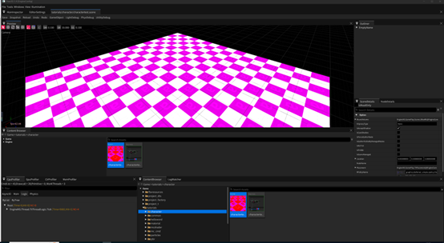
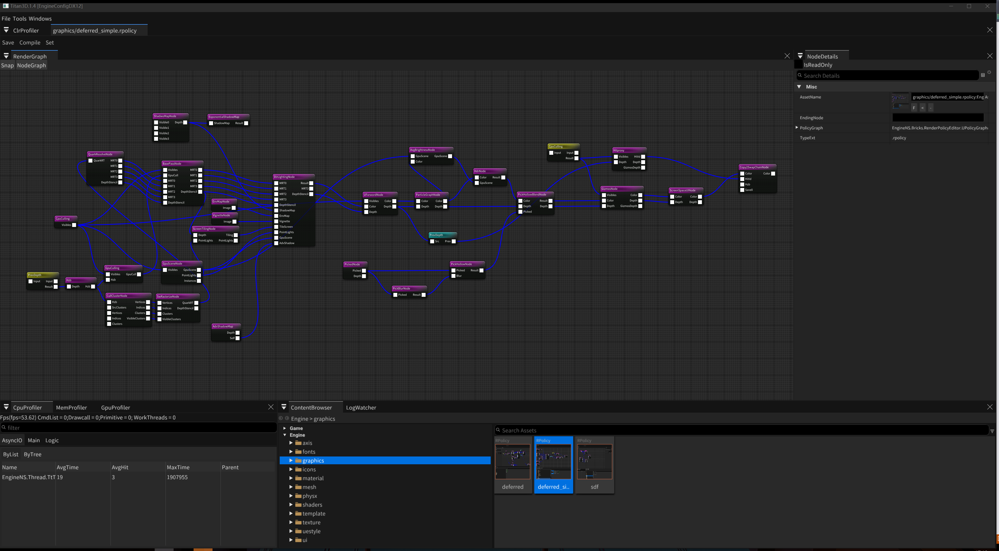

# Architecture Highlights (Industry Comparison)

> **TitanEngine's Render Dependency Graph (`TtRenderGraph` / `TtAttachmentCache`) is benchmarked against UE5 RDG / Unity URP-HDRP Render Graph / Frostbite FrameGraph / Granite / O3DE Atom / Stride GraphicsCompositor / Falcor / Bevy bevy_render.**
>
> **One-line positioning: Tier-1 RDG capabilities (topology pruning / refcount / transient pooling / auto barrier all in place) + a rare visual editor for the *main* rendering pipeline + Permutation / RenderPolicy as first-class editable assets — fewer than 5 engines worldwide combine all three.** Both UE5 and Unity expose their RDG as pure C++/C# API; the main pipeline is *not* visually editable.
>
> Full feature matrix, roadmap, and design-philosophy comparison: → **[Documents/engine/RenderGraph.Industry.Compare.md](Documents/engine/RenderGraph.Industry.Compare.md)**

# Compilation and Runtime Environment
- Titan3D Launches!
- 
- 1. Install Visual Studio 2026 (.NET SDK 10.0.4xx requires MSBuild 18; the native projects use the MSVC v145 toolset bundled with VS 2026, so the v143 component is no longer needed)
- 2. Install .NET SDK 10.0.4xx (global.json pins 10.0.100 with rollForward=latestFeature) and Windows SDK 10.0.19041 or newer
- 3. Install CMake (the LeanCLR static libraries are built with CMake)
- 4. Only when packaging for Android: the .NET mobile (maui-android) workload plus Android SDK/NDK
- The authoritative dependency list, versions and validation rules live in BuildScript/common/dependencies.json and BuildScript/check/deps.ps1

# Engine Features
- 1. C++/C# hybrid programming with C++ as the underlying layer and C# as the upper layer. Automatic glue code generation enables complete C++ functionality calls from C#
- 2. Coroutine-based multithreading architecture that eliminates Callback Hell
- 3. Macro-based visual scripting architecture allowing users to implement complex game logic without coding
- 4. Fully customizable rendering pipeline - edit RenderGraph via editor and extend RenderGraphNode through C# for truly customized effects
- 5. Built-in multi-process server cluster architecture suitable for large MMO projects
- 6. HLSL-based shading development with unified cross-platform shader reflection for rendering resource binding, following native DX development conventions

# Supported Features
- 1. Supports DX11, DX12, Vulkan, OpenGLES (deprecated)
- 2. Supports Windows and Android platforms
- 3. Amplification Shader, Mesh Shader, RayTracing Shader
- 4. Visual editor for configuring RenderGraph assets with built-in DeferredShading and MobileShading templates
- 5. Visual Material Shader editor
- 6. InGame UI editor supporting 2D/3D game UI editing
- 7. GPU-driven framework based on GpuScene+IndirectDraw+Bindless
- 8. Particle system with visual logic editing supporting CPU/GPU particle switching
- 9. SDF fonts with scaling-friendly design
- 10. Node-based scene editor where C# scripts can be attached to any Node via world outline
- 11. Visual state machine editor working with macros to implement game logic
- 12. Visual script editor - Macross system can implement nearly all engine functionalities
- 13. Built-in RenderDoc support (configurable)
- 14. TCP/IP-based RPC networking with built-in large-scale server cluster architecture
- 15. Double-precision coordinates supporting CDLOD terrain for infinite worlds
- 16. Automatic Excel data mapping to data structures with auto read/write
- 17. Dynamic plugin loading/unloading for extending both game and engine features
- 18. Dedicated prefab editor

# Default RenderGraph Node List

All rendering pipelines are configured through node connections. Therefore, don't ask what rendering features the engine supports - expanding and combining nodes determines the final rendering pipeline effects.

- 1. CullClusterNode, SwRastererizeNode, QuakResolveNode, etc. for software rasterization (WIP)
- 2. Hzb and depth clip map for depth culling
- 3. CpuCulling for generating visible Node lists on CPU
- 4. DeferredBassPass for deferred rendering (3-4 RT outputs with configurable velocity output)
- 5. ShadowMap for classic CSM shadows
- 6. ScreenTiling for screen partitioning (currently tracking point light influences)
- 7. AdvShadow for large-scale shadow processing based on QTree Clip Map
- 8. DirLighting for PBR deferred shading of directional lights
- 9. Forward node for transparent rendering
- 10. Particle node for particle system driving and rendering
- 11. AvgBright/HDR for dynamic lighting tonemapping and eye adaptation
- 12. Picked, PickBlur, PickHollow, PickHollowBlend, HitProxy for editor pixel selection
- 13. ScreenSpaceUI for screen-space UI rendering (3D UI handled in base pass/forward)
- 14. Other effect nodes:
   - VoxelNode: Creates sparse voxels from viewport
   - FogNode: Height-based fog
   - LuminanceThredhole: Extracts luminance range
   - Bloom: Self-explanatory
   - Additive: Color blending
   - SunShaftDepthThreshole/SunShaftRadialBlur: God Ray effect nodes
   - TAA: Temporal anti-aliasing (works with velocity output)
- 15. Realtime Global Illumination & Denoising Nodes (ReSTIR GI Pipeline)
   - ReSTIRGI (`TtReSTIRGINode`): Realtime GI based on the [ReSTIR GI](https://research.nvidia.com/publication/2021-06_restir-gi-path-resampling-real-time-path-tracing) paper. A single node hosts 4 compute passes: Initial Sampling / Temporal Reuse / Spatial Reuse / Resolve. Supports hardware RT (DXR) and software RT (SDF / BVH) via Permutation switch, plus SkyCube / constant-sky miss shading modes.
   - Denoise (`TtDenoiseNode`): Combined spatial + temporal denoiser in one node:
     - **Spatial**: à-trous wavelet edge-aware bilateral filter, multi-iteration ping-pong (4 iters by default, StepSize = 1/2/4/8), edge-stopping driven by GBuffer Normal + Depth, with built-in firefly luminance clamp to suppress ReSTIR resolve outliers.
     - **Temporal**: motion-vector reprojection + history ping-pong + normal/depth consistency validation. Critical for eliminating frame-to-frame flicker under low-spp ReSTIR / SSR. Toggleable via `EnableTemporal` (auto-falls back to pure spatial if MotionVector pin is left unconnected).

# Compilation and Building
## Entry points
- Setup.bat: first-time preparation. Dependency check -> NuGet restore -> build the codegen tools -> generate glue code (same as BuildScript\build.ps1 -CodeGenOnly). Afterwards Visual Studio can build directly.
- BuildEngine.bat: full command-line build; arguments are forwarded verbatim to BuildScript\build.ps1
- BuildScript\build.ps1 switches:
  - -Configuration Debug|Release|All (default All), affects managed projects only
  - -NativeDll debug|release: overrides the native configuration
  - -SkipRestore / -SkipCodeGen / -SkipNative / -SkipManaged / -SkipPlugins / -SkipTools / -SkipDependencyCheck / -CodeGenOnly
## One source of truth: the native build follows the jscfg
- Both the Core.Window configuration and the glue-code generation configuration come from the NativeDll field of the jscfg, not from -Configuration: content\config\engineconfig_windows_dx12.jscfg -> overridden by cache\config\engine.jscfg -> -NativeDll or /p:TitanNativeDll= wins -> otherwise release
- So -Configuration Debug produces Debug managed assemblies together with a native module built in the jscfg configuration; the build banner reports both when they differ
## Build order (build.ps1)
1. Dependency check: MSBuild version, SDK-shipped Roslyn >= the version required by Directory.Packages.props (analyzers are otherwise rejected with CS9057), Windows SDK, CMake, native third-party paths, NuGet version consistency
2. NuGet restore
3. Build CppWeavingTools / CSharpCodeTools and deploy them to binaries\Tools\net10.0
4. Generate glue code: NativeBinder (parses Core.Window headers) plus RPC/AutoSync/Macross sources into codegen\Windows\NativeBinder; generated once per native configuration
5. LeanCLR static libraries (CMake, BuildScript\leanclr\build-leanclr.ps1)
6. Core.Window.vcxproj (MSBuild x64 with /p:PreferredToolArchitecture=x64)
7. Copy native runtime dependencies (PhysX / GMP / VC OpenMP) to binaries\debug|release
8. Analyzers: CompilingGenerator / TtEngineLints
9. Engine.Window + MainEditor
10. Tools: CSharpCompiler / GameBuilder / TitanCMD / LocalizationTool
11. Plugins: every project under Plugins that carries a *.plugin file (auto-discovered, DataCopyer.All last)
12. DataCopyer reflection stage (TitanRunDataCopyerStage)
## Building inside Visual Studio
- Open EngineAll.sln and build: running CppWeavingTools / CSharpCodeTools by hand is no longer needed. TitanCodeGen.targets builds both tools and generates code before Core.Window / Engine.Window compiles, using codegen\Windows\NativeBinder\.codegen.stamp for incrementality (/p:SkipTitanCodeGen=true skips it entirely)
- Building Engine.Window also nested-builds Core.Window through TitanNativeCore.props (same jscfg configuration), so code generation can run twice per build; the second pass no-ops on the content fingerprint
- New native Bricks need their macro, otherwise C# cannot see the exported functions
## Output locations
- binaries\net10.0: MainEditor / TitanCMD / GameBuilder / TitanProjectEval and the managed engine
- binaries\debug and binaries\release: Core.Window.dll plus native dependencies (only the configuration selected by the jscfg is built)
- binaries\Plugins: plugins; binaries\Tools\net10.0: codegen tools
- intermediate\csharp\<project relative dir>\{obj,bin}: C# intermediates; a clean rebuild only needs intermediate and cache removed
- libclang ships as the libclang.runtime.win-x64 / libClangSharp.runtime.win-x64 NuGet packages and is deployed to binaries\Tools\<TFM>\runtimes\win-x64\native; no manual archive extraction or copying LLVM out of Visual Studio

## Android APK (Windows host)
- Entry point: BuildScript\android\build-android.ps1 -Configuration Debug|Release -Stage All|Native|Managed|Apk (defaults to Debug + All); it must run on a Windows host. Stages cannot skip their prerequisites: Apk hard-validates the native artifact and the reflection state produced by the Managed stage
- Toolchain locations live in cache\config\android-toolchain.json: copy BuildScript\android\AndroidToolchain.example.json and fill in absolute paths (no %VAR% expansion, relative paths resolve against the repo root; -ToolchainConfig or the TITAN_ANDROID_TOOLCHAIN_CONFIG environment variable relocates the file). Preflight with BuildScript\check\check-android-toolchain.ps1 -Stage Native|Managed|Device (exit 0 = ready, exit 2 = a tool is missing)
- Contract: the repo only declares floors, the newest locally installed build that satisfies them is used: NDK r27.x (highest installed), CMake >= 3.24, Ninja, .NET SDK 10 (highest installed in the global.json band), JDK 17+ (the panel prefers 21), the maui-android workload (its install command carries --sdk-version, see the panel); fixed: abi=arm64-v8a, apiLevel >= 28 (engine floor), stl=c++_static
- Native: RefreshSources.cmake (-DTITAN_CHECK=ON) -> GenerateCodegen.cmake (glue into codegen\Android, NDK injected here) -> CMake configure (NDK toolchain, ANDROID_SUPPORT_FLEXIBLE_PAGE_SIZES=ON) -> build -> artifact validation: AArch64 ELF, 16 KB-aligned LOAD segments, only allow-listed system libraries, no exported global operator new/delete
- Managed: Engine.Android builds into binaries\android\net10.0 (explicit -p:TitanPlatform=Android -p:SkipTitanCodeGen=true), then TitanRunDataCopyerStage generates codegen\Android\DataCopyer\Copyer.gen.cs plus .datacopyer.state.json
- Apk: validate the state's platform/configuration -> Stage-AndroidContent.ps1 stages content per Module\AloneGame.Maui\TitanContent.txt into intermediate\android\content\<config> (the manifest only supports ASCII paths) -> dotnet build Module\AloneGame.Maui -f net10.0-android -p:AndroidPackageFormats=apk -p:AndroidKeyStore=false -p:EmbedAssembliesIntoApk=true (Debug defaults to FastDev without embedded assemblies, so the script forces embedding, otherwise the APK cannot install standalone) -> exactly one *-Signed.apk is required
- Outputs: binaries\android\<config>\libCore.Android.so, binaries\android\net10.0\Engine.Android.dll; the APK lands in Module\AloneGame.Maui\bin\<config>\net10.0-android\*-Signed.apk, its path is also written to cache\android_build\<lowercase config>.apk-path.txt and printed as APK=<absolute path>
- Do not build AloneGame.Maui directly in Visual Studio: without native, content and reflection state you only get an empty-shell APK, and the script treats all of them as hard prerequisites
- Editor menu Window -> Android Build: toolchain check (Managed stage) -> optional cook (TitanCMD ExeCmd=SaveAsLastest, the TitanCMD path is resolved from the TFM in dependencies.json) -> build-android.ps1 -Stage Apk, plus adb device listing/deploy; Native/Managed still have to run first. Per-field panel reference, version policy and troubleshooting: [Android build and APK packaging](Documents/editor/AndroidBuild.md)

## macOS (Apple Silicon)
- Entry point: ./setup.sh (forwards to Core.Mac\setup.sh): dependency check -> glue generation -> configure -> build; switches --config Debug|Release (default Debug), --skip-codegen, --check-only, --skip-build; the build directory is always intermediate\cpp\Core.Mac\<config>
- Requirements: Xcode CLT, a native arm64 terminal, cmake >= 3.24, ninja, .NET SDK (resolved from global.json and auto-installed into 3rd\tools\dotnet-sdk when missing, no sudo needed; standalone entry Core.Mac\ensure_dotnet.sh), a static libc++ (3rd\native\llvm-project\install-mac\lib\libc++.a, auto sparse-cloned from llvmorg-22.1.8 and built from source when missing, needs python3, ~10 minutes on first run); PhysX5 / MoltenVK are validated against the module list in Core.Mac\generated\TitanSources.cmake
- Glue code: cmake -DTITAN_CONFIGURATION=<config> -P Core.Mac\GenerateCodegen.cmake parses Core.Mac.vcxproj with the Mac clang profile and writes codegen\Mac (the Windows MSBuild generation entry does not apply on macOS, so managed builds always pass -p:SkipTitanCodeGen=true)
- Native: configure into intermediate\cpp\Core.Mac\<config> (Ninja, arm64, TITAN_MAC_ALLOW_UNDEFINED=OFF, compile_commands.json exported), output binaries\<debug|release>\Core.Mac.dylib
- Managed (use Core.Mac\dotnet.sh instead of dotnet for the same SDK resolution as setup.sh):
  - dotnet.sh build Module/Engine.Mac/Engine.Mac.csproj -c Debug -p:TitanPlatform=Mac -p:SkipTitanCodeGen=true -p:TitanRoot=$PWD/ -> binaries/net10.0/Engine.Mac.dll
  - dotnet.sh build Module/MainEditor/MainEditor.csproj -c Debug -p:SkipTitanCodeGen=true (same for TitanCMD), also into binaries/net10.0
  - dotnet.sh msbuild Module/Engine.Mac/Engine.Mac.csproj -t:TitanRunDataCopyerStage -p:Configuration=Debug -p:TitanPlatform=Mac -p:SkipTitanCodeGen=true -p:TitanRoot=$PWD/ : SkipTitanCodeGen also disables the automatic reflection stage, so run it explicitly or PreInitEngine fails at runtime without DataCopyer
- Verification status: native, Engine.Mac, TitanCMD and DataCopyer pass on real Apple Silicon hardware (Core.Mac\smoke_titancmd.sh exits 0 repeatedly, log in cache\mac_titancmd_smoke.log); the MainEditor window/GPU path and the Release configuration are still unverified. Full ledger and troubleshooting: Core.Mac\VALIDATION.md
- VS Code: the Titan: ... (Mac) tasks in .vscode\tasks.json and the lldb/coreclr configurations in launch.json use the same entry points; MainEditor runs with content/config/engineconfig_mac_vk.jscfg and the working directory binaries/net10.0

# Debugging and Execution
1. Set MainEditor as startup project
2. Debug command line arguments: config=$(SolutionDir)content\config\engineconfig_windows_dx12.jscfg NativeDLL=debug (already in Module\MainEditor\Properties\launchSettings.json together with nativeDebugging)
3. Debug working directory: $(SolutionDir)binaries\
4. NativeDLL= only takes effect when the jscfg sets NativeDll=auto; otherwise cache\config\engine.jscfg wins, and that same value selects the native configuration at build time, so recompile native after changing it
5. NativeMem=0 disables the native memory profiler (on by default); UseRenderDoc / HasDebugLayer and friends are jscfg switches
6. For runtime and debugging, read [**Engine Configuration and Editor Usage Documentation**](Documents/Index.md)
7. For unexpected IO-related crashes/exceptions, try deleting local cache directory

# Developer Notes
1. Avoid committing large files (>20MB) to prevent LFS usage
2. [Common Code Snippets](CodeLib.md)
3. **New C++ Bricks must have corresponding macros added** - otherwise C# won't find C++ functions (see Note 2)

# Console Programs
## Special Parameters
- 1. ExeCmd=Command to execute
- 2. ExtraCmd={n} where n determines the number of console input parameters after launch

## Save Assets to Latest Version
- Resolves MetaVersion explosion by saving specified assets to latest version:

## License
- Licensed under [LGPL v3](LICENSE.md)
