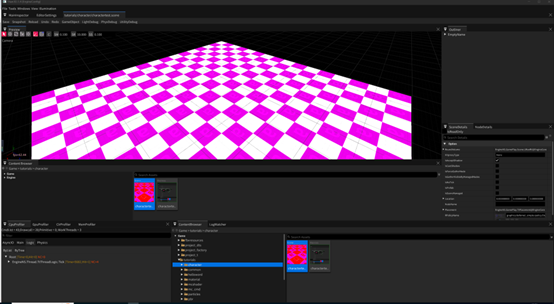
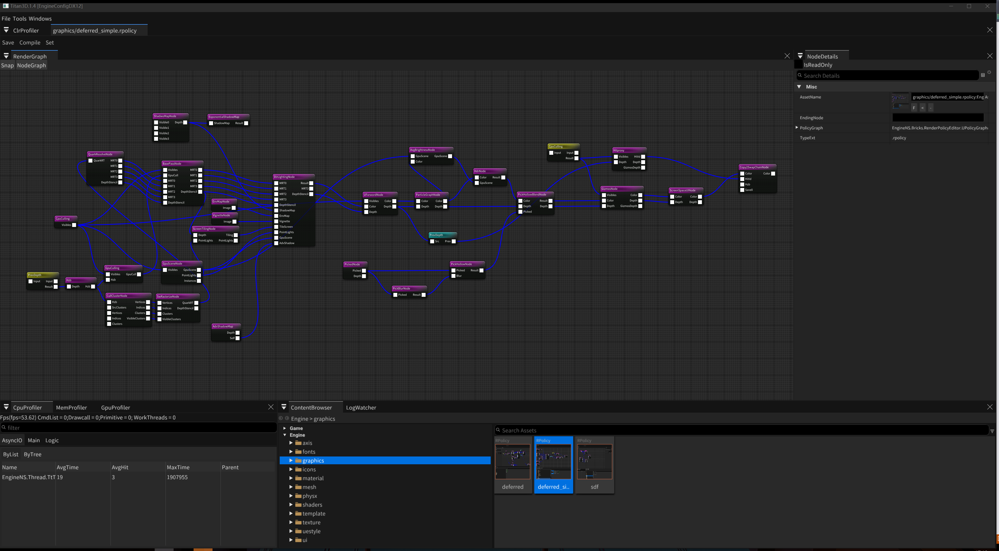

## [English Version](README-Eng.md)

# 为什么用TitanEngine

> **TitanEngine 的 Render Dependency Graph (`TtRenderGraph` / `TtAttachmentCache`) 横向对标 UE5 RDG / Unity URP-HDRP RG / Frostbite FrameGraph / Granite / O3DE Atom / Stride GraphicsCompositor / Falcor / Bevy bevy_render。**
>
> **一句话定位：业界第一档 RDG 能力 (拓扑剪枝 / 引用计数 / Transient 池化 / 自动 barrier 全部具备) + 业界少见的"主渲染管线可视化编辑器" + Permutation / RenderPolicy 资产化 — 三者同时具备的引擎全球不超过 5 个。** UE5 / Unity 的 RDG 都是纯 API，主管线无可视化。
>
> 完整对照表 / 演进路线图 / 设计哲学对比见 → **[Documents/engine/RenderGraph.Industry.Compare.md](Documents/engine/RenderGraph.Industry.Compare.md)**

# 编译运行环境
- Titan3D 启动！
- 
- 1.安装 Visual Studio 2026（.NET SDK 10.0.4xx 要求 MSBuild 18，原生工程使用 VS 2026 自带的 MSVC v145 工具集，无需额外安装 v143）
- 2.安装 .NET SDK 10.0.4xx（global.json 固定 10.0.100 + rollForward=latestFeature）与 Windows SDK 10.0.19041 以上
- 3.安装 CMake（LeanCLR 静态库由 CMake 构建）
- 4.需要编 Android 包时再装 .NET 移动开发（maui-android）工作负载与 Android SDK/NDK
- 依赖的完整清单、版本号与校验逻辑见 BuildScript\common\dependencies.json 与 BuildScript\check\deps.ps1
# 引擎特色
- 1.C++/C#混合编程，C++作为底层，C#作为上层，通过自动胶水代码产生，C#可以完成完整调用C++功能
- 2.基于协程(Coroutines)的多线程构架，告别Callback Hell
- 3.基于宏图的图形化脚本构架，用户可以0代码实现超复杂游戏逻辑
- 4.完全用户自定义渲染管线，通过编辑器编辑RenderGraph，通过C#扩展RenderGraphNode，真正做到用户需要的一切效果都自定制
- 5.自带多进程服务器集群构架，大型MMO项目可用
- 6.基于HLSL的Shading开发，全平台Shader反射后统一了渲染资源绑定，是最接近原生DX开发用户习惯的模式
# 支持特性
- 1.支持DX11,DX12,Vulkan,OpenGLES(废弃)
- 2.支持Windows,Android平台
- 3.Amplification Shader,Mesh Shader,RayTracing Shader
- 4.图形化编辑器配置RenderGraph资产，引擎自带DeferredShading和MobileShading配置RenderGraph资产
- 5.图形化Material Shader编辑器
- 6.InGame UI编辑器支持2D，3D游戏UI编辑
- 7.GpuScene+IndirectDraw+Bindless为基础的GpuDriven框架
- 8.粒子系统，采用图形化逻辑编辑，支持CPU，GPU粒子切换
- 9.SDF字体，放缩友好
- 10.基于Node的场景编辑器，世界大纲可以为任何Node设置C#脚本
- 11.图形化动作状态机，和宏图配合完成游戏逻辑
- 12.图形化脚本编辑器，宏图(Macross)系统几乎可以全功能实现引擎项目功能
- 13.内嵌RenderDoc，可以config配置
- 14.基于TCP/IP的RPC网络通讯，自带超大型服务器集群构架
- 15.采用双精度坐标，支持CDLOD地形，先天无限世界圣体
- 16.Excel数据自动映射数据结构，自动读写
- 17.插件动态加载卸载，游戏，引擎功能都可通过插件扩展
- 18.专用的prefab编辑器
# 当前缺省RenderGraph支持典型节点列表

一切都渲染流程都是节点链接配置出来，所以不要问引擎支持什么渲染特性，扩充和组合节点决定了最终的渲染管线效果
- 1.CullClusterNode,SwRastererizeNode,QuakResolveNode等一系列节点，用来实现软光栅渲染（尚未完全完成）
- 2.Hzb，depth clip map用来做深度裁剪
- 3.CpuCulling，在CPU内处理出可见Node列表
- 4.DeferredBassPass，延迟渲染，3或者4RT输出，最后一个velocity输出可配置
- 5.ShadowMap，经典CSM阴影
- 6.ScreenTiling，屏幕分块，目前主要记录影响的点光源
- 7.AdvShadow，基于QTree Clip Map的大范围阴影处理
- 6.DirLighting，平行光等的PBR延迟着色
- 7.Forward，前向节点，主要处理半透明一类的渲染
- 8.Particle，用来处理粒子系统的驱动和渲染
- 9.AvgBright,HDR用来处理动态光照tonemapping,eye adapter
- 10.Picked,PickBlur,PickHollow,PickHollowBlend,HitProxy用来处理编辑器等的像素点选
- 11.ScreenSpaceUI，用来处理屏幕空间UI渲染（3d UI直接在base pass或者forward中处理）
- 12.其他效果节点
- - 1.VoxelNode，从视口创建稀疏体素
- - 2.FogNode，高度雾
- - 3.LuminanceThredhole，提取亮度区间
- - 4.Bloom，顾名思义
- - 5.Additive，叠加颜色
- - 6.SunShaftDepthThreshole,SunShaftRadialBlur用来做God Ray的系列节点
- - 7.Taa，时域反走样，和前面输出的velocity配合使用
- 13.实时全局光照与降噪节点 (ReSTIR GI Pipeline)
- - 1.ReSTIRGI (`TtReSTIRGINode`)，基于 [ReSTIR GI](https://research.nvidia.com/publication/2021-06_restir-gi-path-resampling-real-time-path-tracing) 论文的实时全局光照, 单节点内含 4 个 compute pass: Initial Sampling / Temporal Reuse / Spatial Reuse / Resolve, 支持硬件 RT (DXR) 和软件 RT (SDF / BVH) Permutation 切换, 支持 SkyCube / 常量天光两种 miss 着色模式
- - 2.Denoise (`TtDenoiseNode`)，空间 + 时域联合降噪节点, 一个节点串完整条降噪管线:
- - - 空间降噪: à-trous wavelet edge-aware bilateral filter, 多迭代 ping-pong (默认 4 iter, StepSize = 1/2/4/8), 用 GBuffer Normal + Depth 做 edge-stopping, 内置 firefly luminance clamp 消除 ReSTIR resolve 偶发 outlier
- - - 时域降噪: motion-vector reprojection + history ping-pong + 法线/深度一致性校验, 是低 spp ReSTIR / SSR 模式下消除帧间闪烁的关键 pass, 可通过 `EnableTemporal` 开关 (MotionVector pin 未连时自动 fallback 到纯空间降噪)
# 编译构建
## 构建入口
- Setup.bat：首次准备。依赖校验 → NuGet restore → 构建代码生成工具 → 生成胶水代码（等价于 BuildScript\build.ps1 -CodeGenOnly）；跑完就可以直接在 Visual Studio 里构建
- BuildEngine.bat：命令行完整构建，参数原样转发给 BuildScript\build.ps1
- BuildScript\build.ps1 参数：
- - -Configuration Debug|Release|All（默认 All），只作用于托管工程
- - -NativeDll debug|release：覆盖 native 编译配置
- - -SkipRestore / -SkipCodeGen / -SkipNative / -SkipManaged / -SkipPlugins / -SkipTools / -SkipDependencyCheck / -CodeGenOnly
## 配置同源：native 编译跟随 jscfg
- Core.Window 的编译配置与胶水代码生成配置都取 jscfg 的 NativeDll，不跟随 -Configuration：content\config\engineconfig_windows_dx12.jscfg → 被 cache\config\engine.jscfg 覆盖 → 命令行 -NativeDll 或 /p:TitanNativeDll= 优先 → 都没有时按 release
- 因此 -Configuration Debug 得到的是 Debug 托管程序集 + 按 jscfg 编译的 native 模块；两者不一致时脚本会在启动横幅里打印提示
## 构建顺序（build.ps1）
1. 依赖检查：VS 的 MSBuild 版本、SDK 自带 Roslyn 不低于 Directory.Packages.props 要求（否则分析器被 CS9057 拒绝加载）、Windows SDK、CMake、原生三方库路径、NuGet 包版本一致性
2. NuGet restore
3. 构建 CppWeavingTools / CSharpCodeTools 并部署到 binaries\Tools\net10.0
4. 生成胶水代码：NativeBinder（解析 Core.Window 头文件）+ RPC/AutoSync/Macross 源码，输出 codegen\Windows\NativeBinder；按 native 配置只生成一次
5. LeanCLR 静态库（CMake，BuildScript\leanclr\build-leanclr.ps1）
6. Core.Window.vcxproj（MSBuild x64，带 /p:PreferredToolArchitecture=x64）
7. 拷贝原生运行时依赖（PhysX / GMP / VC OpenMP）到 binaries\debug|release
8. 分析器：CompilingGenerator / TtEngineLints
9. Engine.Window + MainEditor
10. 工具：CSharpCompiler / GameBuilder / TitanCMD / LocalizationTool
11. 插件：Plugins 下所有含 *.plugin 的工程（自动发现，DataCopyer.All 留到最后）
12. DataCopyer 反射阶段（TitanRunDataCopyerStage）
## 在 Visual Studio 里构建
- 打开 EngineAll.sln 直接构建即可，不需要先手工跑 CppWeavingTools / CSharpCodeTools：TitanCodeGen.targets 会在 Core.Window / Engine.Window 编译前自动构建这两个工具并生成代码，用 codegen\Windows\NativeBinder\.codegen.stamp 做增量，/p:SkipTitanCodeGen=true 可整段跳过
- 构建 Engine.Window 时 TitanNativeCore.props 会嵌套构建 Core.Window（配置同样来自 jscfg），所以一次构建里代码生成可能出现两次，后一次按内容指纹空转
- 新增 C++ Bricks 后记得补对应宏，否则 C# 侧找不到导出函数
## 产物位置
- binaries\net10.0：MainEditor / TitanCMD / GameBuilder / TitanProjectEval 与托管引擎
- binaries\debug、binaries\release：Core.Window.dll 与原生依赖（native 只编 jscfg 指定的那一份）
- binaries\Plugins：插件；binaries\Tools\net10.0：代码生成等工具
- intermediate\csharp\<工程相对路径>\{obj,bin}：C# 中间产物；清理重建只需删 intermediate 与 cache
- libclang 由 NuGet 包 libclang.runtime.win-x64 / libClangSharp.runtime.win-x64 提供，随工具输出到 binaries\Tools\<TFM>\runtimes\win-x64\native，不需要手工解压或拷 VS 的 LLVM
## Android APK（Windows 主机）
- 入口：BuildScript\android\build-android.ps1 -Configuration Debug|Release -Stage All|Native|Managed|Apk（默认 Debug + All），必须在 Windows 主机上运行；分阶段跑时不能跳前置，Apk 会硬校验 native 产物与 Managed 阶段的反射状态
- 工具链位置写在 cache\config\android-toolchain.json：从 BuildScript\android\AndroidToolchain.example.json 复制后填绝对路径（不展开 %VAR%，相对路径按仓库根解析；-ToolchainConfig 或环境变量 TITAN_ANDROID_TOOLCHAIN_CONFIG 可改位置）。预检用 BuildScript\check\check-android-toolchain.ps1 -Stage Native|Managed|Device（exit 0 就绪，exit 2 缺工具）
- 契约只给下限，取本机满足要求的最新：NDK r27.x 任取最高、CMake ≥3.24、Ninja、.NET SDK 10（按 global.json 版本带取本机最高）、JDK 17+（面板优先 21）、maui-android 工作负载（安装命令带 --sdk-version，见面板）；固定 abi=arm64-v8a、apiLevel ≥28（引擎下限）、stl=c++_static
- Native：RefreshSources.cmake（-DTITAN_CHECK=ON）→ GenerateCodegen.cmake（胶水进 codegen\Android，NDK 由它注入）→ CMake configure（NDK toolchain、ANDROID_SUPPORT_FLEXIBLE_PAGE_SIZES=ON）→ 构建 → 产物校验：必须是 AArch64 的 ELF、LOAD 段 16KB 对齐、只依赖白名单系统库、不导出全局 operator new/delete
- Managed：Engine.Android 构建到 binaries\android\net10.0（显式 -p:TitanPlatform=Android -p:SkipTitanCodeGen=true），再跑 TitanRunDataCopyerStage 生成 codegen\Android\DataCopyer\Copyer.gen.cs 与 .datacopyer.state.json
- Apk：先校验 state 的平台/配置 → Stage-AndroidContent.ps1 按 Module\AloneGame.Maui\TitanContent.txt 把内容铺到 intermediate\android\content\<配置>（内容清单只支持 ASCII 路径）→ dotnet build Module\AloneGame.Maui -f net10.0-android -p:AndroidPackageFormats=apk -p:AndroidKeyStore=false -p:EmbedAssembliesIntoApk=true（Debug 默认 FastDev 不嵌入程序集，脚本强制嵌入，否则装不上）→ 要求恰好一个 *-Signed.apk
- 产物：binaries\android\<配置>\libCore.Android.so、binaries\android\net10.0\Engine.Android.dll；APK 在 Module\AloneGame.Maui\bin\<配置>\net10.0-android\*-Signed.apk，路径同时写入 cache\android_build\<小写配置>.apk-path.txt，控制台打印 APK=<绝对路径>
- 不要直接在 Visual Studio 里构建 AloneGame.Maui：缺 native、内容与反射状态时只会得到空壳 APK，脚本里这些前置都是硬校验
- 编辑器菜单 窗口 → Android Build：工具链校验（Managed 档）→ 可选 cook（TitanCMD ExeCmd=SaveAsLastest，TitanCMD 路径按 dependencies.json 的 TFM 解析）→ 调 build-android.ps1 -Stage Apk，另有 adb 列设备/部署；Native/Managed 仍要先跑脚本。面板逐项说明、版本策略与排障见 [Android 构建与 APK 打包](Documents/editor/AndroidBuild.md)
## macOS（Apple Silicon）
- 入口：./setup.sh（转发到 Core.Mac\setup.sh）：依赖校验 → 胶水生成 → configure → build；开关 --config Debug|Release（默认 Debug）、--skip-codegen、--check-only、--skip-build，构建目录固定 intermediate\cpp\Core.Mac\<配置>
- 依赖：Xcode CLT、原生 arm64 终端、cmake ≥3.24、ninja、.NET SDK（按 global.json 解析，缺失时自动装到 3rd\tools\dotnet-sdk，无需 sudo，单独入口 Core.Mac\ensure_dotnet.sh）、静态 libc++（3rd\native\llvm-project\install-mac\lib\libc++.a，缺失时自动 sparse clone llvmorg-22.1.8 并源码构建，需 python3，首次约 10 分钟）；按 Core.Mac\generated\TitanSources.cmake 的模块清单校验 PhysX5 / MoltenVK
- 胶水：cmake -DTITAN_CONFIGURATION=<配置> -P Core.Mac\GenerateCodegen.cmake，用 Mac clang 档解析 Core.Mac.vcxproj，输出 codegen\Mac（Windows 的 MSBuild 生成入口在 Mac 上不适用，托管构建一律 -p:SkipTitanCodeGen=true）
- 原生：configure 到 intermediate\cpp\Core.Mac\<配置>（Ninja、arm64、TITAN_MAC_ALLOW_UNDEFINED=OFF、导出 compile_commands.json），产物 binaries\<debug|release>\Core.Mac.dylib
- 托管（手动命令可用 Core.Mac\dotnet.sh 代替 dotnet，与 setup.sh 共用同一套 SDK 解析）：
- - dotnet.sh build Module/Engine.Mac/Engine.Mac.csproj -c Debug -p:TitanPlatform=Mac -p:SkipTitanCodeGen=true -p:TitanRoot=$PWD/ → binaries/net10.0/Engine.Mac.dll
- - dotnet.sh build Module/MainEditor/MainEditor.csproj -c Debug -p:SkipTitanCodeGen=true（TitanCMD 同理），也产出到 binaries/net10.0
- - dotnet.sh msbuild Module/Engine.Mac/Engine.Mac.csproj -t:TitanRunDataCopyerStage -p:Configuration=Debug -p:TitanPlatform=Mac -p:SkipTitanCodeGen=true -p:TitanRoot=$PWD/：SkipTitanCodeGen 会顺带关掉自动反射阶段，必须显式跑，否则运行时 PreInitEngine 找不到 DataCopyer
- 验证现状：原生 + Engine.Mac + TitanCMD + DataCopyer 已在 Apple Silicon 真机通过（Core.Mac\smoke_titancmd.sh 连续 exit 0，日志 cache\mac_titancmd_smoke.log），MainEditor 窗口/GPU 与 Release 配置尚未验证；完整台账与排障见 Core.Mac\VALIDATION.md
- VS Code：.vscode\tasks.json 的 Titan: ... (Mac) 任务与 launch.json 的 lldb/coreclr 配置走同一套入口，MainEditor 用 content/config/engineconfig_mac_vk.jscfg，工作目录 binaries/net10.0
# 调试与运行
1. 设置MainEditor为当前项目
2. 调试命令行参数为config=$(SolutionDir)content\config\engineconfig_windows_dx12.jscfg NativeDLL=debug（已写入 Module\MainEditor\Properties\launchSettings.json，并开启 nativeDebugging）
3. 调试工作目录为$(SolutionDir)binaries\
4. NativeDll=auto 时命令行的 NativeDLL= 才生效，否则以 cache\config\engine.jscfg 的 NativeDll 为准——它同时也是编译期 native 配置的来源，改了它要重新编 native
5. NativeMem=0 关闭原生内存分析（默认开启）；UseRenderDoc / HasDebugLayer 等开关在 jscfg 里配置
6. 运行与调试，请阅读[**引擎配置与编辑器使用文档**](Documents/Index.md)。
7. 遇到一些奇怪IO相关Crash或者异常，可以尝试删除本地cache目录
# 开发者注意事项
1. 不要提交大文件(20M以上)，避免lfs使用
2. [常用代码](CodeLib.md)
3. **新增加了C++的Bricks一定要记得添加对应宏**，否则会C#找不到C++函数，方法参阅注意事项2
# 控制台程序
## 特殊参数
- 1.ExeCmd=决定执行的命令
- 2.ExtraCmd={n}这个n是确定启动后，控制台可以输入的参数个数
## 保存资产到最新
- 保存指定资产到最新版本，解决MetaVersion爆炸问题
ExeCmd=SaveAsLastest AssetType=Scene+Mesh+Material+MaterialInst+Texture CookCfg=\$(SolutionDir)content\config\engineconfig_windows_cook.jscfg 
## 启动Root服务器
- 方法1：ExeCmd=StartRootServer CookCfg=\$(SolutionDir)content\config\engineconfig_windows_rootserver.jscfg 
- 方法2：ExtraCmd=1 CookCfg=$(SolutionDir)content\config\engineconfig_windows_rootserver.jscfg 在控制台输入ExeCmd=StartRootServer
## 启动Login服务器
- 方法1：ExeCmd=StartLoginServer CookCfg=\$(SolutionDir)content\config\engineconfig_windows_rootserver.jscfg 
- 方法2：ExtraCmd=1 CookCfg=$(SolutionDir)content\config\engineconfig_windows_rootserver.jscfg 在控制台输入ExeCmd=StartLoginServer
## 升级CppWeavingTools
- 升级 libclang：改 Directory.Packages.props 里的 ClangSharp / libclang.runtime.win-x64 / libClangSharp.runtime.win-x64 版本（macOS 对应 osx-arm64 包），并同步 BuildScript/common/dependencies.json 的 managedNuGetPackages 版本，随工具输出到 binaries\Tools\<TFM>\runtimes\win-x64\native
## 授权许可证
- 采用[LGPL v3 许可](LICENSE.md)